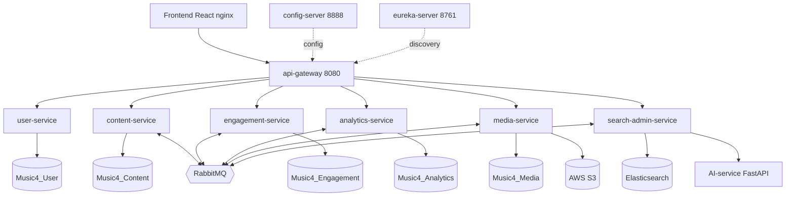

# MSS301 – Music4 Microservices: Kế hoạch tổng thể bám barem

> Tài liệu cho cả team. Đọc cùng `MSS301-microservices.md` (thiết kế domain) và `Music4-refactor-events.md` (event contract, luồng gợi ý/sync ES). Mục tiêu: **100% điểm chính + 50% bonus, 0% penalty.**

**Phạm vi dự án (tránh nhầm với môn PRM):**

| Môn | Backend | Frontend |
| --- | --- | --- |
| **MSS301** (tài liệu này) | Repo `music4-mss301/music4_microservice`: Maven multi-module, `pom.xml` gốc là aggregator, mỗi service một thư mục ở gốc | `Music4-Frontend` (React + Vite), gọi qua api-gateway `:8080` |
| PRM393 (không thuộc tài liệu này) | `Music4-Backend` (monolith) | App Flutter |

Code monolith đã được xóa khỏi repo MSS (vẫn còn trong lịch sử Git). Mọi thay đổi cho MSS không đụng tới `Music4-Backend` và app Flutter.

---

## Cập nhật 20/10: ĐỔI DATABASE SANG POSTGRESQL (Neon), BỎ SQL SERVER DOCKER

Giảng viên cho phép host DB trên **Supabase hoặc Neon**, nên **bỏ SQL Server Docker và bỏ kế hoạch Azure SQL**. Mọi chỗ bên dưới nhắc tới SQL Server, `docker-compose.db.yml`, `init.sql` hay Azure SQL là **bản cũ**; nội dung mới nằm ở đây.

| Hạng mục | Quyết định mới |
| --- | --- |
| Loại DB | **PostgreSQL**, 5 database riêng: `music4_user`, `music4_content`, `music4_engagement`, `music4_analytics`, `music4_media` (+ Elasticsearch cho search) |
| Host | **Neon** (free, tạo được nhiều database, không hết hạn). Supabase chỉ có 2 project free nên khó chia 5 DB, giữ làm dự phòng |
| Dev | Mỗi người một project Neon riêng (miễn phí) |
| Demo và Render | Một project Neon chung (ví dụ `music4-prod`) do Tài giữ. Render chỉ cần đặt `DB_URL`, `DB_USERNAME`, `DB_PASSWORD` cho từng service |
| Docker | Chỉ còn RabbitMQ, Elasticsearch, AI-service và (sau này) các container service. **Không còn container DB** |
| Việc bỏ | Không cần đăng ký Azure, không cần `azure-init.sql`, không còn xung đột cổng 1433 |
| Code | Đã vá bằng `to-postgres/apply.py`: pom (`postgresql`, `flyway-database-postgresql`), `application.yml`, entity (`TEXT`), migration viết lại bằng PostgreSQL, câu truy vấn có tham số NULL được ép kiểu `CAST(:p AS string)` |
| Tiêu chí barem | **DB per service** vẫn đạt: 5 database riêng, mỗi service chỉ nối DB của mình |

Lưu ý cho tiêu chí Docker: compose đầy đủ sẽ đọc `DB_URL` từ biến môi trường trỏ tới Neon, các container Java gọi nhau qua tên trong mạng Docker.

---

## Cập nhật 17/10: trạng thái sau khi sinh code

Patch `music4-microservices-src.zip` đã có code đầy đủ cho 6 service + gateway + config-server. **Code chưa được build bằng Maven** (môi trường sinh code không vào được Maven Central): việc đầu tiên của cả team là `mvn -DskipTests package` và sửa lỗi compile nếu có. Ghi chú chi tiết trong `CHANGES-src.md` của patch.

### Đối chiếu barem

| Tiêu chí | Trạng thái | Việc còn lại | Owner |
| --- | --- | --- | --- |
| Service per domain | **Đã có** | Không | Cả team |
| DB per service | **Đã có**: 5 DB SQL Server, migration T-SQL riêng, ES cho search | Đã có `docker-compose.db.yml` + `deploy/sqlserver/init.sql` (5 DB, 5 login); gộp vào compose chính | Tài |
| Business & API | **Đã có**: CRUD + rule + DTO `@Valid` + `GlobalExceptionHandler` ở cả 6 service | Mỗi người viết ≥ 3 unit test cho rule của service mình | Từng owner |
| Service Discovery | **Đã có**: Eureka client, Feign gọi theo tên | Không | Tài |
| API Gateway | **Đã có**: route, verify JWT, chặn `/internal/**`, CORS, fallback 503 | Không | Nhựt |
| Config Server | **Đã có**: module `config-server` + `config-repo/` | Mount `config-repo` khi chạy Docker; tập demo đổi `play-dedupe-seconds` | Nhựt |
| Circuit Breaker | **Đã có**: Resilience4j cho mọi Feign client + gateway | Tập demo tắt search-admin, gợi ý vẫn ra trending | Quốc |
| Docker usage | **Chưa** | Dockerfile multi-stage cho 8 module Java + FE | Tài |
| Production deploy | **Chưa** | `render.yaml`, 5 DB Azure SQL free, CloudAMQP, ES, Vercel | Tài |
| Spring Security | **Đã có**: BCrypt, JWT, RBAC `@PreAuthorize`, gateway verify, `X-Gateway-Secret` | Không | Nhựt |
| *Bonus* Docker compose | **Chưa** | SQL Server + init, RabbitMQ, ES, config, eureka, service, healthcheck | Tài |
| *Bonus* Tracing + health | **Một nửa**: Actuator health đã có | Thêm `micrometer-tracing-bridge-otel`, exporter Zipkin, container Zipkin | Quỳnh |
| *Bonus* CI/CD | **Chưa** | GitHub Actions: build + test + image + deploy hook | Quốc |
| *Bonus* Monitoring | **Chưa** | `micrometer-registry-prometheus`, Prometheus + Grafana dashboard | Kiên |
| *Bonus* ELK | **Chưa** | `logstash-logback-encoder` + `logback-spring.xml`, Logstash + Kibana | Tài |

### Penalty

| Penalty | Trạng thái |
| --- | --- |
| Không dùng Spring Boot | AI-service vẫn là Python (đã sửa đọc Eureka/API key từ env). Vẫn cần hỏi giảng viên sớm |
| Password không hash | Đã xử lý: BCrypt khắp nơi, seed dùng hash, `Artist` bỏ cột password |
| Demo không chạy được | Rủi ro lớn nhất lúc này: chưa build. Làm theo thứ tự việc bên dưới |
| Không hiểu code | Rule nghiệp vụ nằm trong `service/impl`, có comment `Rule:` ngay trên method. Mỗi người đọc và tự giải thích được service của mình |

### Việc ngay tuần này (theo thứ tự)

1. **Cả team:** `mvn -DskipTests package`, sửa lỗi compile (nếu có) trong service của mình.
2. **Cả team:** chạy local với SQL Server (Docker) + RabbitMQ + ES, đăng nhập bằng `admin/Admin123`, `artist/Artist123`, `listener/Listener123`, thử Swagger từng service qua gateway.
3. **Tính (FE):** `artistId` khác `userId`; stream đầy đủ thêm `?token=`; ảnh/nhạc qua `/api/media/...`; follow chỉ gửi `artistId`; rating không gửi `userId`; bỏ URL hardcode `localhost:8080`.
4. **Tài:** Dockerfile + docker-compose + init DB (làm trước vì tracing, monitoring, CI/CD đều cần). **Quốc:** CI/CD.
5. **Từng owner:** unit test cho rule.
6. **Bonus + deploy:** Quỳnh tracing, Kiên Prometheus/Grafana, Tài ELK (Logstash + Kibana) và deploy production. **Nhựt** tập demo Config Server, **Quốc** tập demo Circuit Breaker.

### Thay đổi thiết kế so với các mục bên dưới

- Mọi tài khoản (kể cả nghệ sĩ) nằm ở user-service; `users.artist_id` trỏ hồ sơ nghệ sĩ. Vì vậy comment/notification chỉ cần `userId`, **bỏ** quy ước `actorType` ở mục 1 cũ.
- Quản lý user của admin nằm ở **user-service** (`/api/users`, quyền ADMIN); search-admin chỉ lo dashboard, reindex, curation, dọn lịch sử.
- Search có fallback: ES lỗi thì tìm bằng DB của content (`source = "database"` trong response).

---

## 0. Hiện trạng so với barem (đã kiểm tra trong `MSS301.zip`)

| Có rồi | Thiếu (phải làm) |
| --- | --- |
| 6 service + gateway + eureka-server đã có skeleton | **Config Server chưa có** |
| DB riêng + Flyway cho 5 service, `ddl-auto: validate` | **Resilience4j (Circuit Breaker) chưa có** |
| user-service có Spring Security + JJWT | Service khác chưa có Security; **gateway chưa verify JWT** |
| Gateway route theo `lb://` | **Chưa có Dockerfile** cho service Java (chỉ AI-service có) |
| docker-compose có ES, RabbitMQ, AI | Chưa có DB container, init script, service Java, observability. **DB giữ SQL Server, chạy bằng Docker theo yêu cầu giảng viên (mục 7.1)** |
|  | Actuator chỉ ở gateway; chưa có tracing/Prometheus/ELK/CI/CD |
|  | Controller/Service logic chưa có (mới entity) |

---

## 1. Bảng điểm và người chịu trách nhiệm

Điểm chính (100%):

| Tiêu chí | % | Hạng mục đạt điểm | Owner chính | Bằng chứng khi demo |
| --- | --- | --- | --- | --- |
| Service per domain | 10 | 6 service theo domain + AI sidecar | Cả team | Sơ đồ + Eureka dashboard |
| DB per service | 10 | 5 DB SQL Server riêng + ES (search) + AI không DB; mỗi service login/connection string riêng | Tài | 5 DB trong SSMS/Azure Data Studio, grep không có FK chéo |
| Business & API | 15 | CRUD đủ mọi service, business rule, DTO + `@Valid`, `GlobalExceptionHandler` | Từng owner | Swagger + test 409/400/403 |
| Service Discovery | 10 | Eureka, mọi service đăng ký, gọi bằng `lb://` / Feign theo tên | Tài | Eureka dashboard |
| API Gateway | 10 | Route + JWT filter + CORS + fallback | Nhựt | FE chỉ gọi `:8080` |
| Config Server | 10 | Module `config-server`, config tập trung, service import từ đây | Nhựt | Đổi 1 giá trị, restart, thấy đổi |
| Circuit Breaker | 5 | Resilience4j + fallback ở Feign và gateway | Quốc | Tắt 1 service, hệ thống vẫn trả fallback |
| Docker usage | 10 | Dockerfile mỗi service, chạy e2e trong container network | Tài | `docker compose ps` toàn healthy |
| Production deploy | 10 | FE Vercel + BE Render + DB Azure SQL free (SQL Server) | Tài | URL public chạy end-to-end sau warm-up |
| Spring Security | 10 | JWT, RBAC, gateway validate, BCrypt | Nhựt | Gọi API không token ra 401, sai role ra 403 |

Bonus (+50%):

| Bonus | % | Owner | Bằng chứng |
| --- | --- | --- | --- |
| Docker compose 1 lệnh (kể cả DB + init script) | 10 | Tài | `docker compose up -d --build` trên máy sạch |
| Distributed tracing + Actuator health | 10 | Quỳnh | 1 request xuyên gateway→service→service có chung traceId trên Zipkin |
| CI/CD (GitHub Actions) | 10 | Quốc | Badge xanh, workflow build+test+docker+deploy |
| Monitoring Prometheus + Grafana | 10 | Kiên | Dashboard JVM/HTTP/Circuit Breaker |
| Centralized logging ELK | 10 | Tài | Kibana tìm log theo `traceId` |

Penalty cần tránh: xem **mục 11**.

---

## 2. Kiến trúc cuối cùng

Observability (chạy song song, không nằm trong đường đi request): Zipkin, Prometheus, Grafana, Logstash, Kibana (dùng chung Elasticsearch với index `music4-logs-*`).

### Bảng port

| Thành phần | Port |  | Thành phần | Port |
| --- | --- | --- | --- | --- |
| config-server | 8888 |  | media-service | 8085 |
| eureka-server | 8761 |  | search-admin-service | 8086 |
| api-gateway | 8080 |  | AI-service | 8000 |
| user-service | 8081 |  | SQL Server | 1433 |
| content-service | 8082 |  | RabbitMQ | 5672 / 15672 |
| engagement-service | 8083 |  | Elasticsearch / Kibana | 9200 / 5601 |
| analytics-service | 8084 |  | Zipkin / Prometheus / Grafana | 9411 / 9090 / 3000 |

---

## 3. Phân công 6 thành viên

| Người | Service sở hữu | Hạ tầng / bonus kèm theo |
| --- | --- | --- |
| **Nhựt** | user-service | **API Gateway**, Spring Security toàn hệ thống (JWT, RBAC, BCrypt), template `GlobalExceptionHandler`, **Config Server** |
| **Quỳnh** | content-service | **Bonus Tracing + health** (Micrometer Tracing + Zipkin), unit test rule của content |
| **Tính** | engagement-service | RabbitMQ topology (exchange, queue, DLQ), **Frontend** đổi base path/env (build cho Vercel) |
| **Tài** | analytics-service, AI-service | **DB per service** (init 5 DB/role), **Eureka**, **Dockerfile**, **docker-compose**, **Production deploy**, **Bonus ELK** (Logstash + Kibana, `logback-spring.xml` cho các service) |
| **Kiên** | media-service | **Bonus Monitoring** (Prometheus + Grafana dashboard), unit test rule của media |
| **Quốc** | search-admin-service | **Circuit Breaker** (Resilience4j + fallback, kịch bản demo), **Bonus CI/CD** (GitHub Actions), unit test rule của search-admin |

**Tài giữ phần hạ tầng nền** (DB, Eureka, Docker, compose, deploy, ELK). Config Server, Circuit Breaker và 3 bonus còn lại chia cho các bạn. Tính tập trung vào engagement, RabbitMQ và Frontend. Mọi phần hạ tầng đều chạy chung một docker-compose, nên ai thêm container (Zipkin, Prometheus, Grafana, Logstash, Kibana) hoặc thêm dependency vào pom thì báo Tài để gộp vào compose. Giảng viên có thể hỏi bất kỳ ai về bất kỳ phần hạ tầng nào, nên mỗi owner giải thích lại phần của mình cho cả team trước buổi tập demo (mục 11).

Mỗi người ≥ 1 service + ≥ 1 hạng mục hạ tầng. Hạng mục hạ tầng nào cũng có đúng 1 owner để tránh "ai cũng tưởng người kia làm".

---

## 4. Đặc tả từng service (CRUD, business rule, validation)

Quy ước chung cho **mọi service**: DTO request/response riêng (không trả entity), `@Valid` + Bean Validation, `GlobalExceptionHandler` trả JSON thống nhất `{timestamp, status, error, message, path, errors[]}`, mã lỗi: 400 validate, 401 chưa đăng nhập, 403 sai quyền, 404 không có, 409 vi phạm business rule.

### 4.1 Ma trận CRUD

| Service | Resource | C | R | U | D | Quyền |
| --- | --- | --- | --- | --- | --- | --- |
| user | Users / Profile | register | me, list(admin) | update me, đổi role/lock (admin) | xóa (admin) | public / USER / ADMIN |
| user | Auth | login, refresh, verify, reset |  | đổi mật khẩu | logout (revoke) | public / USER |
| content | Track | ARTIST | public | ARTIST (của mình) | ARTIST/ADMIN |  |
| content | Album | ARTIST | public | ARTIST (của mình) | ARTIST/ADMIN |  |
| content | Artist profile | auto khi tạo tài khoản artist | public | ARTIST (của mình) | ADMIN |  |
| content | Category | ADMIN | public | ADMIN | ADMIN |  |
| engagement | Playlist (+tracks) | USER | owner/public | owner | owner | USER |
| engagement | Favorite, Follow, Rating | USER | owner | Rating: upsert | owner | USER |
| engagement | Comment | USER | public | owner | owner/ADMIN | USER |
| engagement | Notification | hệ thống (event) | owner | đánh dấu đã đọc | owner | USER |
| analytics | History | USER (khi nghe) | owner | cập nhật `listenedSeconds` | xóa 1 mục / xóa hết (owner) | USER |
| analytics | Stats / Recommendation |  | USER / ADMIN |  |  |  |
| media | MediaFile | upload | metadata + stream | thay file | xóa (ADMIN hoặc qua event) | ARTIST/ADMIN |
| search-admin | **Curation** (ghim kết quả theo từ khóa, lưu ở ES index `search_curations`) | ADMIN | ADMIN | ADMIN | ADMIN | ADMIN |
| search-admin | Search / Suggest / Reindex / Admin Dashboard |  | public / ADMIN |  |  |  |
| AI | `/api/ai/embed`, `/health` | stateless, không CRUD |  |  |  | API key nội bộ |

`Curation` là resource CRUD riêng của search-admin, để service này cũng có CRUD đầy đủ dù không có SQL DB.

### 4.2 Business rule (mỗi dòng phải có test trả 409/400/403)

| Service | Rule |
| --- | --- |
| **user** | Email unique. Mật khẩu ≥ 8 ký tự gồm chữ và số. User bị khóa không đăng nhập được. Không khóa/xóa/hạ quyền **admin cuối cùng** hoặc chính mình. Refresh token rotate, logout thì revoke. Token verify/reset dùng 1 lần và có hạn. Chỉ ADMIN đổi role. |
| **content** | Track phải có ≥ 1 artist, file và `duration > 0`. Artist chỉ sửa/xóa track-album **của mình**. Track thuộc album thì album phải cùng artist. Tên track **unique trong cùng album** (giống "không double-booking"). Không xóa category đang có track (409). Không xóa artist còn track (409). |
| **engagement** | Favorite unique `(user, track)`. Rating 1–5, mỗi user-track 1 rating (upsert). Không follow chính mình, follow unique. Playlist: chỉ owner sửa/xóa; track **không trùng trong playlist**; tối đa 500 track; playlist private không ai khác xem được. Comment 1–500 ký tự, chỉ owner/ADMIN xóa. Chỉ owner đánh dấu đọc notification. |
| **analytics** | Chỉ ghi history cho user đã đăng nhập. Nghe lại **cùng track trong 30 giây** thì bỏ qua (chống spam view). `listenedSeconds ≤ duration`. Stats toàn hệ thống chỉ ADMIN. Gợi ý loại trừ track bị rating ≤ 2. |
| **media** | Chỉ nhận mp3/wav/jpg/png/webp, ≤ 50 MB, kiểm tra theo content-type **và** magic bytes. `objectKey` unique. Audio đầy đủ cần JWT, **preview công khai**. Xóa file khi track bị xóa (event). |
| **search-admin** | Curation: từ khóa unique. Reindex chỉ chạy **1 lần tại một thời điểm** (đang chạy thì trả 409). Mọi API admin cần ROLE_ADMIN. |

---

## 5. Spring Security

| Hạng mục | Thiết kế |
| --- | --- |
| Hash mật khẩu | **BCrypt** (strength 10+). Không có cột/nơi nào lưu plaintext, **kể cả seed**: script seed admin phải dùng chuỗi hash BCrypt. Bỏ `password` khỏi `Artist` ở content. |
| Token | JWT HS256, access ngắn (khuyến nghị 1 giờ), refresh 7 ngày lưu DB. `JWT_SECRET_KEY` chỉ nằm ở `.env`/Config Server, **không commit**. |
| Gateway | Global filter: public path (`/api/users/login`, `/register`, `/refresh`, `/api/content/**` GET, `/api/search/**`, stream preview) bỏ qua; còn lại verify chữ ký + hạn. Xóa mọi `X-User-*` client gửi, rồi gắn `X-User-Id`, `X-Role`, `X-Gateway-Secret`. |
| Service con | `spring-boot-starter-security` + filter đọc header tạo `Authentication`, từ chối nếu thiếu `X-Gateway-Secret` (không gọi thẳng cổng service được). Dùng `@PreAuthorize("hasRole('ADMIN')")`, kiểm tra ownership theo `X-User-Id`. |
| RBAC | `LISTENER`, `ARTIST`, `ADMIN`. |
| Nội bộ | `/internal/**` không được route qua gateway, kèm `X-Internal-Token`. |
| CORS | Cấu hình duy nhất tại gateway. |

---

## 6. Spring Cloud

### 6.1 Config Server (Nhựt)

- Module mới `config-server` (port 8888), backend `native`: thư mục `config-repo/` được mount vào container.
- Cấu trúc: `config-repo/application.yml` (chung: eureka, actuator, tracing, resilience4j mặc định) và `<service>.yml` riêng.
- Service dùng `spring.config.import: configserver:http://config-server:8888` + retry, **fail-fast** để lỗi rõ khi không có Config.
- Secret (DB password, JWT, AWS) vẫn qua biến môi trường, file YAML chỉ chứa `${VAR}`.
- Demo: đổi giá trị trong `config-repo`, restart service, thấy hành vi đổi.

### 6.2 Eureka và Gateway

- Mọi service tên cố định `spring.application.name`; Feign gọi theo tên (`@FeignClient(name = "content-service")`).
- Gateway route giữ như hiện tại, thêm `RewritePath` nếu FE chưa kịp đổi, thêm CB và fallback `/fallback/{service}`.

### 6.3 Circuit Breaker (Quốc)

Resilience4j `@CircuitBreaker` + `@TimeLimiter` trên Feign client (timeout 800ms–2s, sliding window 10, failure 50%, open 10s). Cấu hình mặc định đặt trong `config-repo/application.yml`.

| Caller → Callee | Khi callee chết, fallback |
| --- | --- |
| gateway → mọi service | Trả 503 JSON chuẩn |
| analytics → engagement (signals) | Signals rỗng, chuyển sang **trending** |
| analytics → search-admin (recommend) | Trending từ HISTORY 7 ngày |
| engagement → content (batch tracks) | Trả `trackId` + `available: false` |
| engagement → user (batch users) | Hiện "Người dùng" mặc định |
| search-admin → AI (embed) | Index không vector, `needsEmbedding = true` |
| content → media (upload) | 503 rõ lý do (không có fallback hợp lý) |

---

## 7. Docker và docker-compose (Tài)

- **Mỗi service Java**: Dockerfile multi-stage (`maven` build → `eclipse-temurin:21-jre`), chạy non-root, `HEALTHCHECK` gọi `/actuator/health`. Frontend: build Vite → nginx. AI: giữ Dockerfile, sửa `main.py` đọc env Eureka.
- **SQL Server 2022** (`mcr.microsoft.com/mssql/server:2022-latest`) chạy bằng Docker theo yêu cầu giảng viên. Container `sqlserver-init` chạy `deploy/sqlserver/init.sql` một lần: tạo 5 DB (`Music4_User`, `Music4_Content`, `Music4_Engagement`, `Music4_Analytics`, `Music4_Media`) + **5 login riêng**, mỗi login chỉ là `db_owner` của DB mình. Bảng và dữ liệu demo do Flyway tạo, mật khẩu seed đã hash BCrypt. Cần ≥ 2 GB RAM cho container.
- Thứ tự khởi động bằng `depends_on: condition: service_healthy`: `sqlserver → sqlserver-init → rabbitmq/es → config-server → eureka → các service → gateway → frontend`.
- Một network `music4-net`; trong container dùng tên host (`sqlserver`, `eureka-server`...), **không dùng localhost**.
- Một lệnh: `docker compose up -d --build`. Có `docker-compose.lite.yml` bỏ nhóm observability cho máy yếu.
- Dùng profile Spring `docker` cho cấu hình URL trong container.

### 7.1 SQL Server chạy bằng Docker (yêu cầu giảng viên)

| Việc | Chi tiết |
| --- | --- |
| Chạy riêng DB | `docker compose -f docker-compose.db.yml up -d` (đặt `MSSQL_SA_PASSWORD`, `DB_SERVICE_PASSWORD` trong `.env`) |
| Gộp vào hệ thống | Copy 2 service `sqlserver` + `sqlserver-init` vào `docker-compose.yml` chính; service Java `depends_on: sqlserver-init: condition: service_completed_successfully` |
| Kết nối | Trong Docker: `jdbc:sqlserver://sqlserver:1433;databaseName=Music4_User;encrypt=true;trustServerCertificate=true`, user `music4_user_svc` (tương tự 4 DB còn lại) |
| Tiếng Việt | Mọi cột chuỗi là `NVARCHAR`, DB collation `Vietnamese_CI_AS`, Hibernate `use_nationalized_character_data=true` |
| Bẫy SQL Server | Cột UNIQUE cho phép NULL (vd `artists.user_id`) phải dùng filtered index `WHERE user_id IS NOT NULL`; `AVG` trên cột INT phải `CAST` sang số thực |
| Mac chip M | Image chỉ có x86_64: bật Rosetta trong Docker Desktop |
| Kiểm tra | SSMS/Azure Data Studio kết nối `localhost,1433` bằng `sa`: thấy 5 DB, mỗi DB có bảng `flyway_schema_history` |

---

## 8. Production deploy (Tài): Vercel + Render + dịch vụ free bên ngoài

### 8.1 Giới hạn thật của Render Free (kiểm tra tháng 10/2026)

- Free web service: **512 MB RAM, 0.1 CPU**; ngủ sau **15 phút** không có request, bật lại mất khoảng **1 phút**.
- **750 giờ free mỗi workspace mỗi tháng, dùng chung** cho mọi free service. 8 service cùng thức ≈ **\~90 giờ cả hệ thống/tháng**, hết giờ thì bị suspend.
- Render không có SQL Server và container SQL Server cần ≥ 2 GB RAM (free chỉ 512 MB), nên DB production dùng Azure SQL. Private service/worker **không có free** (từ Starter, 7 USD/tháng).
- Hệ quả: không chạy nổi Eureka, Config, ES, RabbitMQ, ELK trên Render free. Chỉ deploy **gateway + 6 service + AI** (8 web service) và dùng dịch vụ ngoài cho phần còn lại.

### 8.2 Ai chạy ở đâu

| Thành phần | Production | Ghi chú |
| --- | --- | --- |
| Frontend | **Vercel** | Biến `VITE_API_URL` trỏ URL gateway trên Render |
| api-gateway, 6 service Java | **Render Web Service** (Docker, Free) | Khai báo trong `render.yaml` (Blueprint), `healthCheckPath: /actuator/health` |
| AI-service | Render Web Service (Free) | Torch + sentence-transformers **không vừa 512 MB**: đổi sang `fastembed` (ONNX), dùng đúng model `all-MiniLM-L6-v2` (384 chiều) và **kiểm tra vector khớp** với bản đang dùng |
| SQL Server (5 DB) | **Azure SQL Database free offer**, 5 DB | Tối đa 10 DB/subscription, mỗi DB 100.000 vCore-giây + 32 GB mỗi tháng, không hết hạn; cùng engine SQL Server nên dùng chung migration. Không áp dụng cho gói "Azure for Students Starter" (dùng "Azure for College Students" hoặc Azure Free). DB serverless tự pause khi rảnh, lần kết nối đầu mất khoảng 1 phút (đã đặt `connection-timeout: 60000`) |
| RabbitMQ | **CloudAMQP Little Lemur** (free) | 1 triệu message/tháng, 20 kết nối, 100 queue: đủ cho 6 service |
| Elasticsearch | **Elastic Cloud trial 14 ngày** | Tạo **ngay trước ngày bảo vệ**. Bonsai có gói free nhỏ (125 MB, 35K document) nhưng **chưa xác nhận hỗ trợ `dense_vector`/kNN**, cần thử trước. Không có ES thì dùng fallback `ILIKE` (8.4) |
| S3 | Giữ AWS S3 |  |
| Config Server, Eureka | Chỉ chạy trong docker-compose | Xem 8.3 |
| Grafana, Zipkin, ELK | Chỉ chạy trong docker-compose | Bonus demo ở local |

### 8.3 Profile `render` (dùng URL tĩnh thay Eureka/Config)

Cả hai profile cùng một codebase, chọn bằng biến `SPRING_PROFILES_ACTIVE`:

|  | `docker` (compose, demo Spring Cloud đầy đủ) | `render` (production) |
| --- | --- | --- |
| Config | Config Server | Biến môi trường trên Render (`spring.cloud.config.enabled=false`) |
| Discovery | Eureka, gọi bằng `lb://` | `eureka.client.enabled=false`, gọi URL công khai |
| Feign | `@FeignClient(name = "content-service", url = "${services.content.url:}")` | url rỗng thì dùng Eureka; có giá trị thì gọi thẳng |
| Gateway route | `${CONTENT_SERVICE_URL:lb://content-service}` | `https://content-xxx.onrender.com` |

**Đánh đổi cần nói thẳng:** trên production Render, Service Discovery và Config Server không chạy. Hai tiêu chí này được chứng minh bằng docker-compose. Nếu giảng viên đòi thấy chúng trên production thì deploy thêm 2 free service (tốn thêm giờ và thêm \~1 phút cold start mỗi lần).

### 8.4 Việc bắt buộc khi deploy

- Free service **không có private network**, nên mọi lời gọi giữa service đi qua URL công khai. `/internal/**` vì vậy **phải** bị chặn bởi `X-Internal-Token` (kiểm tra bằng test: không token thì 401/403).
- JVM chạy trong 512 MB: `JAVA_TOOL_OPTIONS=-Xmx300m -XX:+UseSerialGC -XX:TieredStopAtLevel=1`. Với 0.1 CPU, Spring Boot có thể mất vài phút để khởi động (ước tính, cần đo thực tế).
- Azure SQL: mở firewall "Allow Azure services" + IP Render (hoặc 0.0.0.0–255.255.255.255 khi demo), JDBC `encrypt=true;trustServerCertificate=false`; tạo login/user riêng cho từng DB (contained user).
- Chuỗi cold start: gateway thức trước nhưng service sau còn ngủ. Dùng `scripts/warmup.sh` gọi song song `/actuator/health` của cả 8 service **10 phút trước demo** và chờ tới khi toàn bộ trả 200. **Không** bật ping giữ thức 24/7 vì sẽ cạn 750 giờ.
- Khi ES chưa sẵn sàng hoặc hết trial: search-admin fallback sang tìm bằng `ILIKE` qua content-service (một ca Circuit Breaker nữa để demo).
- Muốn chạy 24/7 không ngủ: mỗi service Starter 7 USD/tháng (8 service ≈ 56 USD/tháng). Chỉ cân nhắc quanh ngày bảo vệ.

**Tài chốt:** (1) Tài giữ tài khoản Render, Azure, CloudAMQP, Elastic Cloud và cấp quyền cho team khi cần; (2) chấp nhận bỏ Eureka/Config khỏi production hay deploy thêm; (3) ngày tạo Elastic trial; (4) AI-service sang ONNX và kiểm tra vector.

---

## 9. Bonus

| Bonus | Cách làm | Owner |
| --- | --- | --- |
| **Tracing + Health** | Mọi service thêm `spring-boot-starter-actuator`, `micrometer-tracing-bridge-otel`, `opentelemetry-exporter-zipkin`. Sampling 100% khi demo. `traceId` in vào log. Zipkin ở 9411. | Quỳnh |
| **Prometheus + Grafana** | `micrometer-registry-prometheus`, scrape `/actuator/prometheus` của mọi service. Grafana có dashboard **provisioned sẵn** (JVM, HTTP rate/latency, trạng thái Circuit Breaker, RabbitMQ). | Kiên |
| **ELK** | `logstash-logback-encoder` xuất JSON, gửi TCP tới Logstash → ES index `music4-logs-*` → Kibana (data view tạo sẵn). Log có `service`, `traceId`. Dùng chung container Elasticsearch đã có (index riêng `music4-logs-*`), chỉ thêm Logstash + Kibana. | Tài |
| **CI/CD** | GitHub Actions: (1) PR: build + test từng module (matrix), (2) merge `main`: build image, đẩy GHCR, (3) gọi **Render Deploy Hook** cho từng service. Frontend tự deploy bởi Vercel (Git integration). | Quốc |
| **Compose 1 lệnh** | Xem mục 7. | Tài |

---

## 10. Quy ước phát triển

- Repo mono: `music4-microservices/` (root pom đã liệt kê module). Thêm `config-server`, `config-repo/`, `deploy/` (compose, init.sql, prometheus, grafana, logstash), `.github/workflows/`, `scripts/`.
- Branch: `main` (luôn demo được), `dev`, `feature/<service>-<việc>`. **Mỗi người commit bằng tài khoản của mình**, PR phải có người khác review.
- Commit message: `feat(content): add album ownership check`.
- Cấu hình bí mật: `.env` nằm trong `.gitignore`, chỉ commit `.env.example` cho từng service. **Rotate** các key AWS/Google/mail đã nằm trong zip nếu từng push lên git.
- Mỗi service có `README.md` ngắn: chạy thế nào, endpoint chính, rule, event.

---

## 11. Phòng penalty

| Penalty | Rủi ro thực tế trong dự án | Biện pháp | Check |
| --- | --- | --- | --- |
| **Không dùng Spring Boot (−20%)** | AI-service viết bằng **Python/FastAPI**; giảng viên có thể coi là vi phạm | 100% service nghiệp vụ là Spring Boot. Trình bày AI-service là **sidecar suy luận** (stateless) chỉ search-admin gọi. Nếu giảng viên khắt khe, phương án dự phòng: thay bằng Spring service dùng DJL/ONNX hoặc gọi API embedding | Hỏi giảng viên sớm |
| **Password không hash (−20%)** | `Artist.password` ở content, seed SQL, `.env` mẫu | BCrypt mọi nơi, bỏ password khỏi Artist, seed bằng hash, grep repo tìm `password` plaintext | Kiểm tra DB tay trước demo |
| **Demo không chạy được (−20%)** | 20 container, nhiều phụ thuộc, deploy nặng | Healthcheck + `depends_on`, `scripts/smoke-test.sh`, `scripts/warmup.sh` (đánh thức service Render trước demo), tài khoản demo cố định, URL public **và** bản local, video quay sẵn, **đóng băng code 24h trước**, chạy thử trên máy sạch | Smoke test xanh |
| **Toàn bộ code AI, không hiểu code (−90%)** | Phần lớn code sẽ được sinh bằng công cụ AI | Xem dưới đây | Mỗi người tự giải thích được |

### Quy tắc "hiểu code mình viết"

1. Mỗi người **đọc từng dòng** service của mình, chạy debug ít nhất 1 luồng chính, tự sửa/thêm tối thiểu 1 rule hoặc endpoint **bằng tay** trước khi nộp.
2. PR được người khác review; người review phải hỏi được 1 câu về code đó.
3. Chuẩn bị bộ câu hỏi mà giảng viên hay hỏi và **mỗi người trả lời được bằng lời của mình**:
   - Vì sao tách service theo domain này? Dữ liệu nào thuộc service nào?
   - Request đi từ FE đến DB qua những bước nào? JWT được verify ở đâu?
   - Khi service A chết thì chuyện gì xảy ra? Circuit Breaker mở khi nào?
   - Tại sao dùng event thay vì Feign ở chỗ này? Nếu event bị mất thì sao?
   - BCrypt là gì, vì sao không dùng MD5/SHA?
   - Config Server khác `application.yml` thường ở chỗ nào?
   - Giải thích 1 business rule và chỉ ra dòng code xử lý nó.
4. Mỗi người có phần **thuyết trình riêng** về service của mình (2–3 phút).

---

## 12. Kịch bản demo (\~10 phút)

1. `docker compose ps`: toàn bộ healthy. Mở Eureka: tất cả service UP.
2. Đăng ký/đăng nhập (BCrypt trong DB), gọi API không token ra 401, sai role ra 403.
3. Artist upload track (media → S3) rồi thấy track xuất hiện trong search (sync ES), follower nhận notification (RabbitMQ).
4. Nghe nhạc, xem Recommendation. **Tắt search-admin**, tải lại: vẫn ra trending (Circuit Breaker mở, xem trên Grafana).
5. Zipkin: 1 trace xuyên nhiều service. Kibana: tìm log theo `traceId`. Grafana: dashboard.
6. Đổi 1 giá trị ở `config-repo`, restart, thấy đổi (Config Server).
7. Mở URL production (đã chạy `scripts/warmup.sh` trước đó) + GitHub Actions run xanh.

---

## 13. Lộ trình và kế hoạch patch

| Giai đoạn | Nội dung | Ai |
| --- | --- | --- |
| **P0 Nền móng** | `config-server`, sửa `eureka-server`, compose khung, **migration T-SQL + SQL Server Docker (mục 7.1)**, init 5 DB + login, Dockerfile mẫu, profile `docker`/`render`, template exception/validation | Tài (hạ tầng), Nhựt (template exception/security) |
| **P1 Security** | user-service đầy đủ, gateway JWT filter, header filter cho service con | Nhựt |
| **P2 Content + Media** | CRUD + rule, upload qua media, event `content.*` | Quỳnh, Kiên |
| **P3 Engagement** | CRUD + rule, consumer event, Feign batch + CB | Tính |
| **P4 Analytics + AI** | History CRUD, `analytics.track.played`, gợi ý + fallback trending | Tài |
| **P5 Search-admin** | Sync ES, reindex, Curation CRUD, recommend nội bộ | Quốc |
| **P6 Observability** | Actuator, tracing, Prometheus/Grafana, ELK | Quỳnh (tracing), Kiên (monitoring), Tài (ELK) |
| **P7 CI/CD + Deploy** | Workflow, `render.yaml`, Azure SQL, CloudAMQP, Elastic Cloud, Vercel, `warmup.sh` | Quốc (CI/CD), Tài (deploy) |
| **P8 Hoàn thiện** | FE đổi path, smoke test, tập demo, Q&A, freeze | Cả team |

**Prompt tiếp theo** sẽ sinh patch theo thứ tự P0 → P8 ở trên (hoặc từng patch riêng theo yêu cầu).

---

## 14. Checklist nghiệm thu cuối

- [ ] 6 service nghiệp vụ Spring Boot + gateway + eureka + config-server, mọi service UP trên Eureka
- [ ] 5 DB SQL Server (Docker) + login riêng; không FK/join chéo service
- [ ] CRUD đủ cho mọi service (mục 4.1), mỗi rule ở 4.2 có test
- [ ] Mọi mật khẩu BCrypt, kể cả seed; không có secret trong git
- [ ] Gateway verify JWT; service con từ chối request thiếu `X-Gateway-Secret`
- [ ] Config Server đang cấp cấu hình cho mọi service
- [ ] Circuit Breaker + fallback cho các cặp ở mục 6.3
- [ ] Dockerfile mỗi service; `docker compose up -d --build` chạy e2e từ máy sạch
- [ ] Production (Vercel + Render + Azure SQL) hoạt động sau `warmup.sh`; CI/CD xanh
- [ ] Tracing, Grafana dashboard, Kibana có dữ liệu
- [ ] Smoke test xanh; video demo dự phòng; mỗi thành viên trả lời được bộ Q&A